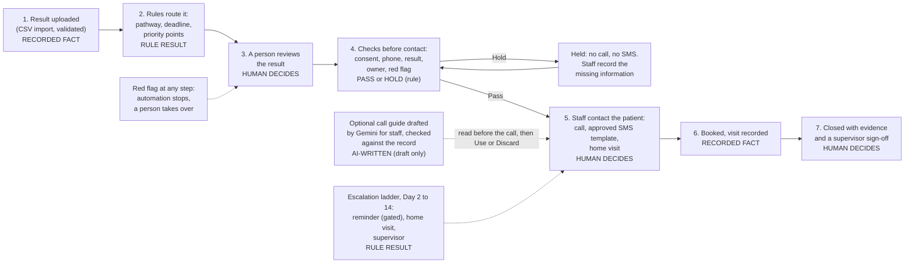

# LoopCloser

**Every result has a next action, an owner, a deadline, and a documented outcome.**

Team BKD KUBO · Future Health Digital Innovation Challenge · Challenge 05: Closing the Screening-to-Care Loop.

Manuel III Ocaña, Product Lead & Solution Architect · Elson Mojica, Domain Lead (Collections & Follow-up) & QA.

## How it works: each step, and exactly where AI sits



AI appears in one place only: an optional call guide that staff can read before phoning a patient. It never
decides, never sends a message, and never changes a case. Rules decide routing, deadlines, priority and the
pass/hold checks; people review, contact and close. The case page labels every piece of content as a
**Recorded fact**, a **Rule result** or **AI-written** ([screenshot](docs/screenshots/v2/16-case-labels-and-gates.png)).

## For judges: start here

| | |
|---|---|
| **Live demo** | https://loopcloser-bkdkubo.web.app (no sign-in needed: use Demo mode) |
| **Video (under 3 min)** | ⚠️ PLACEHOLDER: video link to be added by the team |
| **Pitch deck** | ⚠️ PLACEHOLDER: deck link to be added by the team |
| **Measured results** | [EVAL.md](EVAL.md): 57 of 57 labeled synthetic cases follow the published rules, 0 false positives, 0 false negatives |
| **Judging criteria** | [How LoopCloser meets the judging criteria](#how-loopcloser-meets-the-judging-criteria) |
| **Assumptions and limitations** | [Assumptions and limitations](#assumptions-and-limitations); fuller notes in [docs/assumptions-and-limitations.md](docs/assumptions-and-limitations.md) |

> **First load can take about 10 seconds.** The API scales to zero when nobody is using it, so it costs nothing at
> idle. After the first request it answers in well under a second. All data is **SIMULATED** and fictional.

### Demo path: 14 scripted patients (no sign-in)

> This path is for the `finalist-v2` build. The live site still runs the earlier build until it is redeployed
> after the early review; locally: `make api`, `make web`, `make seed`. Every patient below is **SIMULATED**.

The seed adds 14 hand-written stories (`api/loopcloser/synth/generator.py`, `DEMO_STORIES`) on top of 1,000
generated patients. Each story is replayed through the same commands the app uses (`synth/stories.py`), so its
timeline is real events, not pasted text. Type the case id into **Find a case** on Today, or open `/case?id=...`.

1. **Lead story: C-DEMO-01, Nena Bautista, positive FIT.** Sign in as **Coordinator (demo)** and open C-DEMO-01.
   The readable timeline shows the whole loop: result reviewed, first call missed on Day 2, automatic SMS
   reminder on Day 4, the ladder's community health worker step and a home visit on Day 7, colonoscopy booked on
   Day 8, visit completed on Day 11, closed on Day 12 with structured evidence (visit date, facility, record
   number DH-26-0417) and a supervisor's sign-off. Press **See the patient's phone** for the SMS she received (`/phone`).
2. **C-DEMO-02, red flag.** A patient reports a severe headache: automation stops, a human task opens, and
   "Prepare for the call" is refused until a person resolves it.
3. **C-DEMO-03, nobody owns it.** A new result with no owner. Press **Advance 1 day** (supervisor) and it
   escalates instead of waiting silently.
4. **C-DEMO-04, close blocked.** Visit completed, but **Sign off and close** stays off until a visit date, facility
   and record number are entered and a supervisor ticks the sign-off; as a coordinator the checklist says a
   supervisor's sign-off is still needed. The API refuses a close without them too (rules CLOSE-1, CLOSE-2, CLOSE-3). The patient's name and
   phone are hidden until you press **Show name and phone**, and that reveal is logged (rule PRIV-1).
5. **C-DEMO-05, lost contact.** Three failed calls trigger escalation (rule ESC-1) and the "lost contact" count.
6. **New in feedback-v3:** as Coordinator open **Import FHIR**, press **Load sample bundle**, **Check bundle**,
   then **Import**: a new case opens with consent not recorded. On **See the patient's phone** press YES, RESCHED
   or STOP (simulated replies) and watch the case update in another tab. Book from the simulated slot picker on a
   case that is ready to book (e.g. C-DEMO-07 after its no-show). Today shows an "At risk of dropping off" strip.
7. Others to try: **C-DEMO-06** transport barrier, **C-DEMO-07** no-show, **C-DEMO-08** declined and closed with
   a documented reason and a supervisor's sign-off, **C-DEMO-09** speaks Cebuano (needs a navigator, +1 priority), **C-DEMO-10** has no phone so the
   SMS reminder is skipped, **C-DEMO-11** borderline result, **C-DEMO-12** critical and urgent, **C-DEMO-13**
   32 days overdue and escalated.
7. **C-DEMO-14, missing information: the system holds instead of acting.** Consent to contact was not recorded
   at screening. **Checks before contact** shows Consent on Hold (the other four pass), Call and Message show
   "on hold", the Day 4 SMS reminder in the ladder and timeline says it was held and not sent, and the API
   refuses a call or SMS with rule GATE-1. A home visit is still allowed. Record consent ("Patient agreed to be
   contacted", with how it was obtained) and the hold lifts; the consent is an event in the timeline.
8. On any case, **Download** gives a printable summary (Save as PDF) and the audit trail as CSV or JSON. Staff
   only; each download is logged (rule PRIV-2).
9. Then open **Today** (summary sentence, My cases, screening filter), **Dashboard** (program view) and
   **Import** (CSV check before anything is saved).

Screenshots of this path: [docs/screenshots/v2/](docs/screenshots/v2/).

## How LoopCloser meets the judging criteria

These are the six official Future Health parameters, as read out in Hack2skill's webinar on 4 November 2026.
Each subsection points to evidence already in this repo. Assumptions and limitations that affect a score are
collected in the next section.

### 1. Health impact and clinical relevance

LoopCloser is built for Challenge 05: Closing the Screening-to-Care Loop. It is a care-continuity system for
the nurse or coordinator at a rural health unit who has abnormal results and no way to see who has been reached,
booked, or lost. The Philippine follow-up gap is cited, not estimated, in [The problem](#the-problem): 34% of
adults have hypertension and 49% of them did not know it (PRESYON-5); only 43% returned after screening in the
DOH-supported CLAMS project; 73% of women with an abnormal result never returned in the Santo Tomas, Laguna
audit. What the product does for that worker (an owner and a deadline, who to call first, automatic escalation)
is described there.

What we do not claim: improved clinical outcomes, or that a clinician has signed off the pathways. The review
template is in [docs/clinical-review.md](docs/clinical-review.md); it is not filled in yet. All demo cases are
fictional, which the webinar said is acceptable.

### 2. Technical depth and architecture

The system is event-sourced: an append-only event log is the source of truth, with rebuildable case projections,
versioned hash-locked pathways, a published priority points table, guard rules, and an escalation ladder. See
[Architecture](#architecture) and [docs/guard-rules.md](docs/guard-rules.md).

Measured results in [EVAL.md](EVAL.md): 57 of 57 labeled synthetic cases follow the published rules (0 false
positives, 0 false negatives), including guard rules 28/28. The same eval includes a ladder-on vs ladder-off
comparison on 1,019 synthetic cases (targets written in commit `d908191` before the run): T1 unaccountable and
T2 silently overdue both went to 0; T3 (177 unowned) and T4 (355 overdue) were unchanged, as targeted; T5 missed
(see [Assumptions and limitations](#assumptions-and-limitations)). API tests on this branch: 154 passed, 3
skipped (they need the Firestore emulator, which needs Java); web tests: 18 passed; `make test`.

### 3. Working solution and demonstration quality

Live demo: https://loopcloser-bkdkubo.web.app (Demo mode, no sign-in). A demo video is still a placeholder in
this README and the deck; the official submission pack for 20 November asks for one, along with the live link
and this documentation. The 14 scripted demo stories and the click path are in
[Demo path](#demo-path-14-scripted-patients-no-sign-in). Screenshots of that path:
[docs/screenshots/v2/](docs/screenshots/v2/) (18 images, including Today, the lead case with closure evidence,
blocked close and contact reveal, Prepare for the call, a red-flag case, CSV import, the program dashboard,
the patient's phone, content labels and pass/hold checks (16), the missing-information case on hold (15),
the AI-written label on a call guide (17, offline template locally) and the printable summary (18)). The live site still runs the earlier build until `finalist-v2` is redeployed.

### 4. Responsible AI, safety and data governance

LoopCloser is not a diagnostic AI. Rules decide the next action, owner, priority and deadline; automation does
not contact a patient until a human has reviewed the result (ladder Day 1 is human review; the reminder step
only runs for reviewed or notified cases). People close cases (reason plus evidence and a supervisor's sign-off;
the API refuses otherwise, rules CLOSE-1, CLOSE-2, CLOSE-3). Red flags stop automation (RF-1, RF-2). Names and phones are hidden
until a logged reveal (PRIV-1). Official patient messages are approved templates only; Gemini never sends them
(MSG-3). AI only drafts a call guide for staff, from masked facts, with every number and date verified; drafts
never change case state. See [The safety line](#the-safety-line). No real patient data is in this demo; all
cases are labeled SIMULATED.

Every case page labels its content as **Recorded fact**, **Rule result** or **AI-written**, and shows
**Checks before contact** (consent to contact, contact details, result on file, owner assigned, no open red
flag) as Pass or Hold with what is missing. Calls and SMS are blocked while consent or a valid phone is
missing (rule GATE-1; demo case C-DEMO-14). The case summary and audit trail can be downloaded by staff, and
each download is logged (PRIV-2).

- **Frameworks:** [docs/frameworks.md](docs/frameworks.md) maps LoopCloser to the six principles of WHO's
  *Ethics and governance of artificial intelligence for health* and to the DECIDE-AI reporting items, with what
  we can report now and what only a pilot would produce. It is a self-assessment, not an external review.

### 5. Scalability and deployment readiness

The app is already deployed on Google Cloud (Cloud Run in asia-southeast1, Firestore, Firebase Hosting and Auth,
Vertex AI, Cloud Logging). Default scale is min 0, max 1 instance, so idle cost is zero, and a US$5/month budget
alert is in place. Demo traffic is expected at about US$0 to 2 per month. The
[production-readiness checklist](#production-readiness-checklist) covers security, shipping, speed, traffic and
survival. Country-specific setup (pathways, ladder days, message templates) is configuration, not code; see
[Beyond the Philippines](#beyond-the-philippines). Honest limits are listed there: only English and Filipino
templates exist, and nothing has been tested outside the Philippines.

### 6. Commercial viability and path to pilot

A 90-day pilot at one rural health unit is proposed, not agreed; no facility has signed up, and pathways still
need clinical sign-off before real patients. How a pilot would produce evidence (first a check against cases
a clinician already knows, then the measures to collect) is in
[docs/pilot-evidence-plan.md](docs/pilot-evidence-plan.md), **a plan, not done**. Who could pay after a pilot is listed as options only (the LGU or
RHU operating budget, or PhilHealth); no discussion has taken place. Cost per facility per month at list prices:
about US$0.34 at 100 abnormal results, about US$0.85 at 300. SMS is not included (sending is simulated; no
provider is chosen yet). Full math: [Pilot and cost](#pilot-and-cost).

## Assumptions and limitations

Fuller write-up: [docs/assumptions-and-limitations.md](docs/assumptions-and-limitations.md).

### What is real and what is simulated

| Part | In this build | Not claimed |
|---|---|---|
| Lab results in | CSV import, or a **FHIR R4 Bundle pasted** on `/fhir` (or a built-in synthetic sample bundle). Patient + Observation / DiagnosticReport (+ ServiceRequest as the referral) are read and mapped by a short LOINC table; the lab's interpretation code decides abnormal or normal. | **No live EHR, lab or HIE connection.** No FHIR server is called. The LOINC table is pending clinical review. |
| SMS to patients | Template messages are rendered and **logged in a simulated outbox**; the patient's phone page shows them. | **No SMS is sent.** No SMS provider is chosen or priced. |
| Patient SMS replies | YES / RESCHED / STOP buttons on the mock phone page **simulate** the patient texting back; each reply is an event and changes the case under rule MSG-4 (STOP stops further SMS). | **No SMS is received.** A real build would take these from an SMS gateway webhook. |
| Phone calls | "Call on my phone" is a `tel:` link that opens the worker's own dialer after the logged reveal; the worker then logs the result. | **LoopCloser places no calls** and records no call audio. |
| Appointment booking | A slot picker over **simulated slots** (fictional clinics, weekdays 09:00 / 10:00 / 11:00 / 14:00, 2 places each, next 14 days); capacity is counted from LoopCloser's own bookings. The booking is stored on the case as a FHIR R4 `Appointment`. | **Not a real clinic schedule**; the Appointment is not sent anywhere. |
| Drop-off risk | Fixed rules with points and an administrative suggestion (rules RISK-*), shown as a Today strip and on the case. | **Not a prediction or ML model**; thresholds are team-chosen and not validated; no percentages. |
| Closing a case | Needs evidence **and** a supervisor's sign-off (rules CLOSE-1, CLOSE-2). | The demo has no separate clinician role; the supervisor stands in as the clinical sign-off. |
| Live updates | Today, the case page and the phone page check for changes every 12 seconds (paused while the tab is hidden). | Not push notifications. |
| Patients and data | 1,000 generated patients plus 14 scripted stories, all SIMULATED. | No real patient data. |

- **All demo cases are synthetic.** The seed is 1,000 generated patients plus 14 hand-written stories, every row
  labeled SIMULATED. Injected failure rates are team test settings, not population statistics
  ([docs/assumptions.md](docs/assumptions.md)).
- **No clinical pilot and no clinician validation yet.** Pathways and patient-message templates are pending
  clinical sign-off. The review template has not been filled in.
- **The ladder reached 70.0% of reachable patients**, against a 90% target (T5: 625 of 893 cases with a valid
  phone had at least one reminder or contact by Day 14; one of the 268 not reached is C-DEMO-14, held on
  purpose by the consent gate). T1 and T2 were met by escalating to a supervisor, not
  by getting care done.
- **The supervisor queue grows to 380 cases** on Day 14 with the ladder on (1 with it off): one person, no cap.
  Overdue cases stayed at 355 in both arms.
- **Dashboard and Today numbers come from demo data**, including the seeded cohort and scripted stories, not
  from a real facility.
- **SMS cost is not priced.** Sending is simulated; no SMS provider is chosen yet, and SMS would likely cost
  more than the Google Cloud figures above.
- **A human reviews each result before any patient contact.** Automation does not message a patient until a
  human has reviewed the result. If nobody reviews it, the ladder makes the case visible to a supervisor but
  does not contact the patient.
- The labeled eval is a conformance test against our own rules, not clinical accuracy. We do not claim improved
  outcomes.

## The problem

Screening only helps if an abnormal result leads to care, and in the Philippines that step is often where people
are lost:

- **34% of Filipino adults have hypertension, and 49% of them did not know it**; only 48% had their blood
  pressure under control (PRESYON-5 nationwide survey, 2,989 adults, April to May 2026, reported by the
  [Philippine Heart Association](https://www.philheart.org/pha2025/pha-latest-news/34-of-pinoy-adults-have-hypertension-prevalence-to-double-by-2040);
  [study abstract](https://doi.org/10.69944/pjc.b95ed271d4)).
- In a Department of Health-supported cervical screening project in Metro Manila (CLAMS), **only 43% of patients
  returned after screening**, even though 94% of those who returned were treated
  ([APAC Women's Cancer Coalition, Philippines report, May 2024](https://womenscancercoalition.org/wp-content/uploads/2024/07/Executive-Summary-APAC-WCC-Philippines-Report-30-May-2024.pdf)).
- A clinical audit of a rural cervical screening program in Santo Tomas, Laguna (2013 to 2017) found that
  **73% of women with an abnormal result never returned** once their follow-up interval had passed (35 of 48)
  ([Journal of Global Health Reports](https://www.joghr.org/article/14149-cervical-cancer-screening-in-low-income-countries-a-report-on-the-implementation-of-cervical-screening-in-luzon-philippines)).

A city health worker in Parañaque who manages cervical screening described the same gap before her team moved
to a shared tracking sheet: *"Because we were using manual reporting, some women were lost during follow-up. We
no longer knew what happened to them after referral."* (published interview,
[Balikas News Network](https://balikas.net/from-paper-based-to-real-time-care-how-paranaque-city-strengthened-progress-to-eliminate-cervical-cancer/);
she is not a LoopCloser user).

> ⚠️ PLACEHOLDER, team to supply: a quote from a nurse, barangay health worker or patient we spoke to ourselves,
> with their role and permission to quote. Do not invent one.

**Who uses LoopCloser:** the nurse or coordinator at a rural health unit who has a stack of abnormal results and
no way to see which patients have been reached, booked, or lost. LoopCloser gives each result an owner and a
deadline, shows who to call first and why, and escalates automatically when nobody follows up.

## The safety line

LoopCloser is a care-continuity and safety system, **not a diagnostic AI**.

1. **Rules decide.** Versioned, cited pathways set the next action and deadline; a published points table sets
   the follow-up priority. No machine learning, no AI in any decision.
2. **People act.** Every state change is an event with the person, their role and the rule that allowed it.
   Automation can only escalate or ask for human review.
3. **People close.** Closing needs a reason, evidence and a supervisor's sign-off; a coordinator prepares the evidence.
4. **Red flags stop automation** until a person resolves them; only a supervisor can resume it.
5. **AI only drafts, for staff.** "Prepare for the call" asks Gemini on Vertex AI for a call guide built from
   masked facts (no names, phone numbers or notes). The draft is labeled "AI draft. Not medical advice.", every
   number and date in it is verified against the case record (unmatched drafts are withheld and cannot be used),
   and the request, Use and Discard are events in the audit log. Drafts are refused while a red flag is open or
   after closure (rule AI-2), only staff can request them, and they never change the case's state, priority,
   owner or deadline. A test enforces that the AI module cannot import the code that changes cases.

> All pathways are **pending clinical sign-off**: the team has no clinician yet. Deadlines are configurable
> defaults pending clinical review.
> Review template for a clinician (blood pressure and cervical pathways, 5 questions):
> [docs/clinical-review.md](docs/clinical-review.md); printable sheet:
> [submission/clinician-review-questions.md](submission/clinician-review-questions.md). Not filled in yet.

## Measured, not estimated

From [EVAL.md](EVAL.md) (57 hand-labeled synthetic cases run through the real API; labels written from our
published rules, so this checks that the code follows them, not clinical accuracy):

| Check | Result |
|---|---|
| Pathway routing, urgency, red flags | 13/13 correct |
| Follow-up priority tier and score | 12/12 correct |
| Guard rules (allow or block) | 28/28 correct, 0 unsafe actions allowed, 0 safe actions blocked |
| Escalation after failed contacts | 4/4 correct |
| API time per request (local, no network) | p50 4.5 ms |
| Live demo, Today view | p50 about 1 s; cold start 7 to 10 s |
| Database cost per patient lifecycle | 14 writes and about 35 reads, about US$0.00002 at list price |
| AI call guide (live, Vertex AI) | 2.7 to 3.6 s per draft; about 420 to 470 input and 160 to 200 output tokens, about US$0.001 per draft |

## Google Cloud: what each part does

| Service | Job in LoopCloser |
|---|---|
| Cloud Run (`loopcloser-api`, asia-southeast1) | FastAPI backend: guard rules, pathways, priority, ladder. Min 0, max 1 instance |
| Firestore `(default)` | Append-only event log per case (source of truth) plus rebuildable case projections |
| Firebase Hosting | Static Next.js app on the CDN; `/api/**` rewritten to Cloud Run, so one origin |
| Firebase Auth | Real sign-in with role claims (Google sign-in provider not switched on yet; judges use Demo mode) |
| Vertex AI (Gemini 3.8 Flash, `global` location) | "Prepare for the call" staff drafts and the summary endpoint, called with the Cloud Run service account (no API key) |
| Cloud Logging and Error Reporting | Structured JSON logs with request ids; errors with stack traces |

Honest gaps (plan in [docs/approval-plan.md](docs/approval-plan.md)): no Model Armor screening yet, no grounding
and no agent framework, on purpose: rules decide, and the AI only drafts from the case record. Gemini 3.8 Flash
is served from Vertex AI's `global` location (it is not offered in asia-southeast1), so draft requests may be
processed outside Singapore; they contain only masked, fictional case facts.

## Cost and spend limits
- Expected cost at demo traffic: about US$0 to 2 per month (see [docs/gcp-project.md](docs/gcp-project.md)).
  Per-facility pilot math is in [Pilot and cost](#pilot-and-cost).
- Cloud Run max 1 instance caps compute. A US$5/month budget alert emails at 50%, 90% and 100%.
- A budget alert does **not** stop spending by itself; the instance cap and Firestore's free daily quota are what
  keep a demo cheap.

## Built during the challenge

Dates are from `git log` (Manila time). The repo history starts on 2026-10-17.

| Date | Commit | What |
|---|---|---|
| 2026-10-17 | `1c1e6e6` | Week 1: event-sourced case model, versioned pathways, synthetic data, auth and roles, Firestore rules, CI (90 files) |
| 2026-10-17 | `f82728f` | Own Google Cloud project, guard against the InvoiceSentinel project id |
| 2026-10-18 | `4f7c7fe` | Week 2: demo mode, priority engine, Today view, case action panel, bilingual templates, escalation ladder |
| 2026-10-18 | `65bfdf6` to `73e8828` | First deploy, fast ladder, Today queries by lane, demo reset tool |
| 2026-11-09 | `e24546c` | README for judges with cited statistics, safety line in the UI, labeled synthetic eval (EVAL.md) |
| 2026-11-09 | `0ea2942` | "Prepare for the call" AI draft on Vertex AI, with fact check and Use/Discard events |
| 2026-11-14 | `d908191` | Ladder on/off targets written down before the comparison was run |
| 2026-11-14 | `d565959`, `7685407` | 13 scripted demo stories, plain statuses, structured closure evidence, logged contact reveal, Today summary and search, dashboard, CSV import screen, patient phone page |
| 2026-11-15 | `a9d131a`, `afbc55d` | After the 4 Nov webinar: content labels (recorded fact, rule result, AI-written), pass/hold checks with consent to contact (GATE-1), missing-information story C-DEMO-14, staff-only logged downloads, workflow diagram, WHO and DECIDE-AI mapping, pilot evidence plan |
| 2026-11-19 | `c6c96c6` to `111e199` | After the finalist feedback (branch `feedback-v3`): closing needs evidence **and** a supervisor sign-off, FHIR R4 Bundle import (paste or sample, no server), simulated patient SMS replies (YES / RESCHED / STOP), tap-to-call, auto-refresh, booking from simulated slots (FHIR Appointment shape), drop-off risk strip |

**Reused from InvoiceSentinel (the team's earlier project):** the stack and the deployment pattern: Next.js static
export on Firebase Hosting, FastAPI on Cloud Run at min 0, Firestore, Gemini, Secret Manager, a budget alert, and
the habit of keeping each project in its own Google Cloud project. **New for this challenge:** everything specific
to screening follow-up: the case state machine and event log, pathways, guard rules, priority points, escalation
ladder, templates, synthetic cohort, eval, and all screens. The first commit added 90 files at once, so git
history alone cannot show which files, if any, were adapted from earlier code.

> ⚠️ PLACEHOLDER, Manuel to confirm: which files (if any) were adapted from InvoiceSentinel, for example the
> Dockerfile, deploy scripts or auth middleware. Only list what is true.

## Why queues and escalation

> ⚠️ PLACEHOLDER, Manuel to write in his own words: how his background in collections (working overdue accounts:
> owner per account, next action and date, contact attempts logged, escalation when nobody acts) shaped
> LoopCloser's Today queue and escalation ladder. Do not add details he has not confirmed.

## Beyond the Philippines

The Philippine setup is configuration, not code. **Pathways** are versioned JSON files
(`api/loopcloser/pathways/data/<id>@<version>.json`: trigger, next action, default deadline, red-flag route,
sources); a new country's pathway is a new file plus a `LOCK.json` entry, and published versions cannot change.
The **escalation ladder** days and steps come from the `LADDER_JSON` environment variable. **Patient messages**
are JSON templates with one text per language, and the clinic phone number is a setting (`CLINIC_PHONE`).
Honest limits: today only English and Filipino template texts exist, and the list of supported languages is a
constant in `imports/csv_validation.py`, so adding a language means adding translations (reviewed by native
speakers) and one line of code. Nothing has been tested outside the Philippines.

## Roadmap (not built)

- **Health record integration:** Malaffi (Abu Dhabi's health information exchange), Oracle Health and Epic are
  possible future integration targets, named in the 4 November webinar. LoopCloser has no integration with any
  of them today; results come in through the CSV import or a pasted FHIR R4 Bundle (no server connection).
- **Consent:** today a yes/no flag with its source, recorded by staff. A real deployment needs the facility's
  consent form and a legal review of local data-protection consent rules.
- **Ladder fixes from the eval:** cap or batch supervisor escalations, and decide with a clinician whether an
  approved reminder may go to unreviewed results near their deadline ([EVAL.md](EVAL.md)).

## Pilot and cost

**Proposal, not an agreement:** a 90-day pilot at one rural health unit (RHU), run by its nurse or coordinator,
with real patients only after clinical sign-off of the pathways and templates. No RHU has agreed to this yet.
Who could pay after a pilot, as **options only**: the LGU or RHU operating budget, or PhilHealth (no discussion
has taken place with either).

**Cost per facility per month** at Google Cloud list prices for asia-southeast1 (Singapore), fetched 2026-11-14
from the official [Cloud Run](https://cloud.google.com/run/pricing) and
[Firestore](https://cloud.google.com/firestore/pricing) pricing pages, before free tiers. Measured inputs from
[EVAL.md](EVAL.md): 14 Firestore writes and about 35 reads per patient lifecycle; about US$0.001 and about 4 s
per Gemini draft. Everything else below is a **planning assumption**, not data.

| Price used | Value |
|---|---|
| Cloud Run, request-based billing, Tier 2 (asia-southeast1): CPU / memory while serving | US$0.0000336 per vCPU-second / US$0.0000035 per GiB-second |
| Cloud Run requests | US$0.40 per million |
| Firestore (asia-southeast1): reads / writes / storage | US$0.0369 / US$0.1107 per 100,000 documents; US$0.1846 per GiB-month |

| Assumption (per facility, per month) | Value |
|---|---|
| Abnormal results entering follow-up | 100 or 300 (illustrative) |
| Writes per patient | 20 (14 measured, plus 6 for ladder steps and escalations) |
| Reads per patient | 35 (measured) plus 6 case-page views of about 16 documents each |
| Staff Today-view loads | 3 staff x 30 loads x 22 working days = 1,980 loads, about 70 reads each (60 cards plus counts) |
| Gemini drafts | 2 per patient |
| Cloud Run billed time | 0.3 s per request, plus 4 s per draft, plus 2 cold starts of 10 s per working day; 1 vCPU, 512 MiB; about 15 requests per patient |

| | 100 results/month | 300 results/month |
|---|---|---|
| Firestore: 2,000 writes and 151,700 reads / 6,000 writes and 177,900 reads | US$0.06 | US$0.07 |
| Gemini: 200 / 600 drafts x US$0.001 | US$0.20 | US$0.60 |
| Cloud Run at min 0: 2,284 s / 4,784 s billed, x (US$0.0000336 + 0.5 x US$0.0000035), plus requests | US$0.08 | US$0.17 |
| **Total, list price** | **about US$0.34** | **about US$0.85** |

At these volumes Firestore stays far inside its free daily quota (about 8,000 reads and 270 writes per working
day against 50,000 and 20,000), and Cloud Run inside its free monthly allowance, so the real bill for one facility
is mostly the Gemini drafts. **Not included:** real SMS (sending is simulated; no SMS provider is chosen yet, and
SMS would likely cost more than everything above), staff time, devices and data plans, a Cloud Scheduler job for
the daily ladder run, and support. **Option with no cold start:** keeping one instance warm (min 1) costs about
US$0.45 per day at the idle rate (US$0.0000035 per vCPU-second and per GiB-second: 86,400 x 1 x 0.0000035 +
86,400 x 0.5 x 0.0000035 = US$0.4536), about US$13.61 per 30 days, shared by every facility on the deployment.

## Architecture

```
Browser (Next.js static export)
   │  Firebase Auth sign-in (ID token with custom claim "role")
   ▼
Firebase Hosting (CDN, cache headers, security headers)
   ├── static pages  ── cached at the edge
   └── /api/**, /health, /ready  ── rewrite ──►  Cloud Run: loopcloser-api (FastAPI)
                                                   │  verifies token, checks role permission,
                                                   │  rate limits, structured logs
                                                   ├── domain/commands.py  (guard rules)
                                                   ├── pathways/ (versioned JSON + LOCK.json)
                                                   ├── ai/assist.py + ai/verify.py (Vertex Gemini drafts, fact check)
                                                   ▼
                                     Firestore ((default) database)
                                       cases/{id}            projection (rebuildable)
                                       cases/{id}/events/{n} append-only event log (source of truth)
Vertex AI (global) ◄── Gemini 3.8 Flash, called with the Cloud Run service account (ADC, no key)
Cloud Logging / Error Reporting ◄── JSON logs with request ids and stack traces
```

Same stack as InvoiceSentinel (Next.js, FastAPI on Cloud Run, Firebase Hosting, Firestore, Gemini,
Secret Manager), but in **its own Google Cloud project** (`loopcloser-bkdkubo`, set once in
[deploy/project.env](deploy/project.env)). Nothing is shared with the InvoiceSentinel project, and the
deploy scripts and CI refuse its id. The web app is a static export served from the Hosting CDN, so it
costs nothing at idle and the API is same-origin. See [docs/gcp-project.md](docs/gcp-project.md) for
project setup, billing and cost.

### Core data model
- **Case state machine** (`api/loopcloser/domain/states.py`): main path *New result → Reviewed →
  Patient notified → Understanding confirmed → Action scheduled → Visit completed → Closed*, exception
  states (*Unable to reach, Declined, Rescheduled, Referral rejected, No-show, Awaiting human review,
  Escalated*) and red-flag states (*Red flag reported → Automation paused → Human task open →
  Clinician contacted / Resolved by human*).
- **Guard rules** (`domain/commands.py`, listed in [docs/guard-rules.md](docs/guard-rules.md)): messages
  never move a case past *Patient notified* and never close it; closing needs a reason, evidence and a
  supervisor's sign-off; urgent cases need a human owner; red flags pause automation and
  only a supervisor can resume it; N failed contacts escalate.
- **Single owner per case**: `owner`, `backup_owner`, `clinician_reviewer`, `next_action`, `due_date`,
  `escalation_level`, contact counters, `closure_reason`. Cases without an owner get a data-quality flag.
- **Append-only event log** (`domain/events.py`, `store/`): every action is an immutable event with actor,
  rule id and fields used. State is derived by folding events (`domain/case.py`). Appends use optimistic
  concurrency, and in Firestore `create()` so an event can never be overwritten. Clients cannot write at all.
- **Versioned pathway library** (`pathways/data/*.json`): abnormal (generic), borderline, positive FIT
  (colonoscopy, not a repeat FIT), elevated blood pressure (WHO: 140 and/or 90 mmHg on two days) as MUST;
  abnormal cervical and new symptoms as SHOULD. Each has sources and a "pending clinical sign-off" badge.
  Deadlines are "configurable default, pending clinical review". `LOCK.json` makes published versions
  immutable: changing one fails the tests, so changes need a new version.
- **Synthetic generator** (`synth/generator.py`): seeded, 1,000 fictional patients plus hand-made edge
  cases, every row labeled `SIMULATED`. Injected failure rates are team test settings, not statistics
  (see [docs/assumptions.md](docs/assumptions.md)).
- **CSV validation** (`imports/csv_validation.py`): row-level errors and warnings, import of valid rows only,
  downloadable error CSV.

## Features

- **Demo mode (judges).** With `DEMO_MODE=true` the sign-in page shows a "Demo mode: pick a role" card and every page
  shows a banner: production uses real Firebase Auth accounts with role permissions. Real sign-in stays available.
- **Follow-up priority (points, not AI).** Critical result +5, red flag +5, deadline passed +4, due within 3 days +3,
  no appointment +3, missed visit +2, transport/cost/work barrier +2, no successful contact +2, comorbidity +1,
  language support +1. Urgent 8+, High 5 to 7, Moderate 3 to 4, Routine 0 to 2. Every case shows a
  "Why this priority?" list. Supervisors can override with a reason and a note; the override is an event and cannot
  lower a case with an open red flag (`domain/priority.py`, rules PRI-1, PRI-2).
- **Today view.** Four lanes (needs action, overdue, waiting for patient, recently completed) sorted by priority,
  with Call, Message, Assign and the recommended action on each card.
- **Case detail action panel.** Next action with the reason, book, reschedule, escalate, close with evidence,
  barriers, escalation ladder status and the full event timeline.
- **Patient message templates.** Five templates in English and Filipino (result notice in 4 parts, reminder,
  short SMS, emergency guidance, booking confirmation), versioned and hash-locked. All are labeled
  **pending clinical and native Filipino speaker review**. Sending is simulated and template only. Gemini never
  sends official messages (rule MSG-3).
- **Escalation ladder.** Day 0 upload, Day 1 human review, Day 2 first contact, Day 4 reminder, Day 7 community
  health worker, Day 10 supervisor (case escalates), Day 14 unresolved review (`domain/ladder.py`, rule LAD-1).
  In demo mode a supervisor can advance a simulated clock to watch it run.

- **Plain statuses and a Today summary (finalist-v2).** Every case shows one of four plain statuses (to contact,
  booked, needs review, done) and "N days overdue". Today opens with one sentence ("377 to contact. 93 overdue...")
  and has My cases, a screening filter and find-by-case-id. Name search is deliberately not offered.
- **Structured closure evidence and supervisor sign-off (rules CLOSE-1, CLOSE-2, CLOSE-3).** Closing needs
  evidence and a supervisor's sign-off. After a visit the evidence is a visit date (not in the future, not before
  the case opened), the facility and a record number in a fixed format; for a declined or unreachable case, a
  documented reference. Coordinators see the same checklist; only a supervisor can sign off.
- **FHIR R4 import (`/fhir`, feedback-v3).** Paste a Bundle or load a synthetic sample (positive FIT, high-risk HPV,
  high blood pressure); Check shows each result as ready, skipped (preliminary or normal) or an error with the reason;
  Import opens the case. Consent starts not recorded (calls and SMS hold), names and phones in the Bundle are never
  stored, and the case shows where it came from (resource, LOINC code, lab interpretation, referral).
- **Simulated patient SMS replies (rule MSG-4).** YES, RESCHED and STOP on the phone page; STOP blocks further SMS.
- **Tap-to-call.** After the logged reveal, "Call on my phone" opens the worker's own dialer, unless a check holds calls.
- **Booking from simulated slots (rules APPT-1, APPT-2).** Pick a clinic and a time; full slots are disabled; the
  booking is stored as a FHIR R4 Appointment on the case.
- **Drop-off risk strip (rules RISK-*).** "At risk of dropping off" on Today and a panel on each case with the
  signs, points and suggested help. On the 1,000-patient demo seed (seed 42, measured 2026-11-19 at seed time):
  907 none, 107 watch, 5 high of 1,019 cases.
- **Auto-refresh.** Today, the case page and the phone page update by themselves when anything changes (checked
  every 12 s, paused in a hidden tab), so an action in one tab shows in another.
- **Content labels.** Every case page has a legend and badges: **Recorded fact** (data on file), **Rule result**
  (pathway, deadline, priority points, checks, ladder steps) and **AI-written** (the Gemini call guide). Timeline
  events carry the same badge, and the downloads carry the same three kinds.
- **Checks before contact (rule GATE-1).** Consent to contact, contact details, result on file, owner assigned and
  no open red flag, each Pass or Hold with what is missing. Calls and SMS (including the automatic Day 4
  reminder) are blocked while consent or a valid phone is missing; a declined consent blocks every contact,
  including home visits. Owner and red-flag holds warn. Staff record consent with its source; it is an event.
- **Downloads (rule PRIV-2).** Printable case summary (`/case/print`, browser Save as PDF) and the audit trail as
  CSV or JSON (`/api/cases/{id}/export/...`). Staff roles only, logged as an event, participant id masked, no
  names or phone numbers.
- **Logged contact reveal (rule PRIV-1).** Names and phone numbers are hidden by default; pressing Show name and phone
  logs who saw which fields (never the values).
- **Program dashboard** (`/dashboard`), **CSV import check** (`/import`) and the **patient's phone** (`/phone`,
  the simulated SMS a patient received).

Screenshots: `docs/screenshots/v2/` (finalist-v2 build, local) and `docs/screenshots/live/` (live demo; 05 shows a verified "Prepare for the call" draft). Deploy plan: `docs/deploy-plan.md`.

## Run locally

```
make install          # Python venv + npm packages
make api              # API on :8080, DEMO_MODE=true, in-memory store
make web              # web on :3000 (another terminal)
make seed             # load 1,000 SIMULATED patients
make test             # API + web unit tests
make test-emulator    # Firestore rules + Firestore repository tests (needs Java 21 and firebase-tools)
make eval             # labeled synthetic evaluation (EVAL.md)
```

Open http://localhost:3000 and pick a role from the Demo mode card (or sign in with Google when Firebase is configured). API docs at http://localhost:8080/docs (off in production).

## Production-readiness checklist

Status: ✅ done in code and tested · 🟡 configured, applied at deploy · ⬜ next

### 1. Security
- ✅ Firebase Auth sign-in; the API verifies ID tokens with the Admin SDK (`api/loopcloser/auth.py`)
- ✅ Five roles (worker, coordinator, supervisor, program manager, patient) with a permission matrix
  (`domain/roles.py`); every route declares the permission it needs; hidden cases return 404
- ✅ Domain guards repeat the critical checks (only a supervisor signs off and closes, only a supervisor resumes automation)
- ✅ Firestore security rules enforce roles: workers read only assigned cases, patients only their own case
  and never the event log, no client writes anywhere (`firestore.rules`, 8 emulator tests)
- ✅ API rate limiting: 120/min per IP, 10/min for imports, AI and demo seeding; `429` with `Retry-After`
- ✅ No AI API key in production: Gemini runs on Vertex AI with the service account (since 2026-11-09). Secret Manager
  still holds the old key, unused. Production never reads `.env`; `.env` files are git-ignored; gitleaks runs in CI
- ✅ Demo mode is off by default and only turns on with `DEMO_MODE=true`. It adds a labeled role switcher on top of
  real Firebase Auth (a Bearer token always wins, demo users are forced to `demo-` ids). Production config refuses
  the memory store and wildcard CORS
- ✅ Participant ids masked for staff (`P-••••42`); logs carry ids only, never names or phones
- ✅ Gemini boundary test: the AI module cannot import commands, stores or pathways
- ✅ Least-privilege service account `loopcloser-api` (Firestore user + Vertex AI user), created at deploy
- ⬜ Real accounts and role assignment (`api/scripts/set_role.py`)

### 2. Shipping
- ✅ GitHub Actions CI: ruff lint and format, pytest, ESLint, TypeScript, vitest, Next build,
  Firestore emulator tests, secret scan (`.github/workflows/ci.yml`)
- 🟡 Deploy workflow, manual trigger, Workload Identity Federation (no JSON keys) (`deploy.yml`)
- 🟡 `deploy/create-project.sh` (one-time project setup) and `deploy/deploy.sh`, both dry run by default,
  plus `deploy/api-service.yaml`; project id in one file, `deploy/project.env`
- ✅ CI fails if the InvoiceSentinel project id appears anywhere
- ✅ Project created and first deploy done on 2026-10-18 (Manila), DEMO_MODE=true ([docs/deploy-plan.md](docs/deploy-plan.md))

### 3. Speed
- ✅ Static export served by the Firebase Hosting CDN; `/_next/static` cached for a year (immutable),
  other assets for a day, HTML revalidated every time
- ✅ API responses `Cache-Control: no-store` (case data is never cached)
- ⬜ Firestore queries with indexes once the case list moves off full scans (indexes already declared)

### 4. Traffic
- ✅ Cloud Run autoscaling: min 0 instances (no idle cost, cold start about 10 s), max 1 for the demo (MAX_INSTANCES in deploy/project.env), concurrency 80, startup CPU boost
- ✅ Health checks used as Cloud Run startup and liveness probes
- ✅ Labeled synthetic evaluation with latency numbers ([EVAL.md](EVAL.md))
- ⬜ Load test with the synthetic cohort; consider min 1 only during a live judging window (costs money, needs approval)

### 5. Survival
- ✅ Structured JSON logs for Cloud Logging with severity, request id, trace id and latency
- ✅ Error tracking: unhandled errors are logged with stack traces in Error Reporting format and the
  user gets a request id to quote
- ✅ `/health` (liveness) and `/ready` (storage, pathway lock, auth mode, AI mode)
- ✅ Projections can be checked against and rebuilt from the event log (`/api/admin/cases/{id}/verify-projection`)
- 🟡 Firestore point-in-time recovery and daily backups, with a restore drill ([docs/firestore-backup.md](docs/firestore-backup.md))
- ⬜ Uptime check and alert policy on `/ready` and on error rate

## What this is not
No diagnosis, no treatment advice, no autonomous triage, no ML risk scores (the drop-off risk is fixed rules),
no LLM decisions, no real SMS or patient data, no live EHR connection, no auto-closure, no claims of improved outcomes.

## Repo layout
```
api/            FastAPI app (loopcloser/), tests/, Dockerfile, scripts/set_role.py
web/            Next.js static app (Today, case, dashboard, import, phone, pathways, status)
firestore-tests/ security rules tests (emulator)
firestore.rules, firestore.indexes.json, firebase.json
deploy/         project.env, project setup + deploy scripts (dry run by default), Cloud Run service
docs/           guard rules, clinical review template, assumptions and limitations, backup plan, simulation assumptions, deploy and approval plans
eval/           labeled synthetic scenarios and the evaluation runner
```
